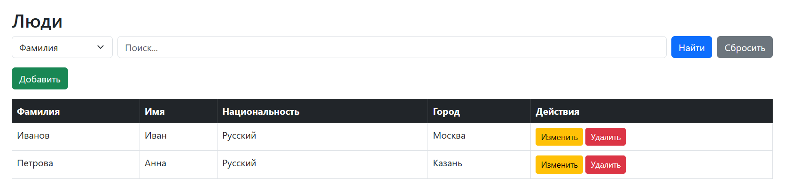
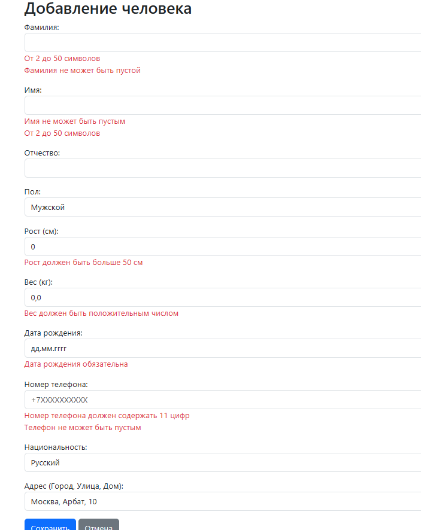

# Лабораторная работа 3. Связи между таблицами и валидация

## Цель работы
Создание Spring-приложения с несколькими связанными таблицами (не менее трех), реализация поиска по трем критериям и применение Bean Validation с использованием паттерна DTO.

## Архитектура проекта
- **Стек:** Spring Boot 3, Maven, Java
- **СУБД:** H2 Database (In-Memory)
- **Основные слои:**
    - Entity (Person, Address, Nationality) — сущности, связанные отношениями @ManyToOne.
    - Repository — интерфейсы Spring Data JPA с кастомными методами поиска (например, findByLastNameContainsIgnoreCase).
    - DTO (PersonDto) — объект для передачи данных с формы и их валидации.
    - Controller (PersonController) — обработка эндпоинтов, перекладка данных из DTO в Entity и обработка BindingResult.
- **Ключевые аннотации:**
    - Базы данных: @ManyToOne, @JoinColumn, @OneToMany, @Id, @GeneratedValue.
    - Валидация: @Valid, @NotBlank, @Size, @Min, @Max, @Positive, @Past, @Pattern, @NotNull.
    - Веб: @ModelAttribute, @RequestParam, @PathVariable, @GetMapping, @PostMapping.@ModelAttribute, @RequestParam, @PathVariable, @GetMapping, @PostMapping.

## Алгоритм работы
1. При запуске JPA генерирует 3 связанные таблицы, после чего скрипт data.sql заполняет их тестовыми данными.
2. При добавлении нового человека или изменении существующего данные с HTML-формы маппятся в объект PersonDto. Срабатывает аннотация @Valid.
3. Если валидация не пройдена, объект BindingResult перехватывает ошибки, и контроллер возвращает пользователя обратно на форму, где Thymeleaf (атрибут th:errors) подсвечивает неверные поля.
4. Если данные корректны, контроллер извлекает связанные объекты Address и Nationality из базы по их ID, собирает Entity Person и сохраняет в БД. Для обновления существующих записей используется скрытое поле ID на форме.
5. Поиск реализован через форму с тегом select. В зависимости от выбранного критерия, контроллер вызывает соответствующий метод репозитория (по фамилии, по городу или по национальности).
6. Удаление реализовано через передачу ID сущности в URL-адресе с проверкой существования записи в базе данных.

## Скриншоты работы приложения

Главная страница и поиск:

Отработка ошибок валидации при добавлении:

